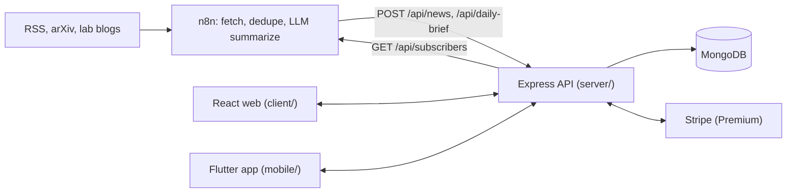

<h1>Global Super Intelligence News (GSIN)</h1>

A news outlet for artificial intelligence and the road to superintelligence. An **n8n** workflow gathers and summarizes stories; this platform publishes them on the **web** and in an **iOS/Android app**, with a free reading experience and an optional **Premium** membership.

Forked from the Helio Intelligence Platform: the Express/MongoDB API, auth, Stripe billing, n8n ingest, daily brief, comments, moderation, and admin tooling were kept and reshaped; the expert-review roles, journals, and referral program were removed.

## What readers get

| | Free (no account) | Free account | Premium |
| --- | --- | --- | --- |
| Every story, topic pages, search, RSS | ✓ | ✓ | ✓ |
| Read discussions | ✓ | ✓ | ✓ |
| Save stories, follow topics ("For you") | | ✓ | ✓ |
| Daily Brief (web, app, email via n8n) | | | ✓ |
| Extended analysis on stories | | | ✓ |
| Post and reply in discussions | | | ✓ |

Set `COMMENTS_FREE=true` on the API to let free accounts post too. Staff roles: **editor** (curate the feed, moderate) and **admin** (also members and entitlements).

## Architecture



```text
gsin/
├── server/    Express + Mongoose API, tests
├── client/    React 18 + Vite web app
├── mobile/    Flutter iOS/Android app
├── samples/   Sample stories and a daily brief (n8n payload shape)
└── docs/N8N_API.md   The n8n contract
```

## Run it locally

Prerequisites: Node 18+, MongoDB (local or Atlas), Flutter 3.27+ for the app.

```bash
# API
cd server
npm install
cp .env.example .env            # set MONGODB_URI, JWT_SECRET, API_KEY
npm run seed                    # loads samples/ as if n8n had posted them
npm run dev                     # http://localhost:4000

# Web (second terminal)
cd client
npm install
npm run dev                     # http://localhost:5173

# Make yourself staff: register on the web, then
cd server && npm run make-admin -- you@example.com admin
```

```bash
# Mobile
cd mobile
flutter pub get
dart run flutter_launcher_icons   # regenerate app icons from assets/icon
flutter analyze && flutter test
flutter run                       # Android emulator: --dart-define=API_BASE_URL=http://10.0.2.2:4000
```

## Connect n8n

Point your workflow's HTTP Request node at `POST {API}/api/news` with header `x-api-key: {API_KEY}`. Payloads from the old Helio workflow are accepted unchanged; RSS-style fields (`link`, `pubDate`, `description`) are also understood. Full contract and a suggested LLM step: [docs/N8N_API.md](docs/N8N_API.md).

## Configuration

API (`server/.env`):

| Variable | Purpose |
| --- | --- |
| `MONGODB_URI` | Must include a database name, e.g. `…/gsin` |
| `JWT_SECRET`, `JWT_EXPIRES_IN` | Sessions |
| `API_KEY` | Shared secret for n8n |
| `CLIENT_URL` | Web origin: CORS, Stripe return URLs, RSS/sitemap links |
| `STRIPE_SECRET_KEY`, `STRIPE_PRICE_ID_PREMIUM`, `STRIPE_WEBHOOK_SECRET` | Premium billing |
| `COMMENTS_FREE` | `true` lets free accounts post |
| `BRAND_NAME`, `BRAND_TAGLINE` | Used in RSS |

Web: rename or re-color in `client/src/brand.js`; set `API_PROXY_TARGET` on Netlify. Mobile: `mobile/lib/brand.dart` and `mobile/lib/config.dart` (`API_BASE_URL`, `WEB_BASE_URL`, `SHOW_UPGRADE_LINKS` via `--dart-define`).

## Deploy

- **API:** Render blueprint in `render.yaml` (or any Node host). Create a Stripe webhook to `/api/billing/webhook` for `checkout.session.completed` and `customer.subscription.*`.
- **Web:** Netlify (`netlify.toml`); `/api/*`, `/rss.xml`, and `/sitemap.xml` are proxied to the API.
- **Mobile:** see [mobile/RELEASE.md](mobile/RELEASE.md). Bundle ID `co.techcatalyst.gsin`; home-screen label "GSIN". Premium is purchased on the web (App Store 3.1.1); build with `--dart-define=SHOW_UPGRADE_LINKS=false` if review requires removing the link-out.

## Tests

```bash
cd server && npm test                                   # uses mongodb-memory-server
TEST_MONGODB_URI=mongodb://127.0.0.1:27017/x npm test   # or any running MongoDB
cd client && npm run build
cd mobile && flutter analyze && flutter test
```

## Design

Cool "clean room" paper, indigo ink, one electric ultramarine accent, and flare red reserved for breaking news. Bricolage Grotesque for headlines and UI, Newsreader for reading text. The signature element is the **GSIN lockup**: the exponential-curve mark, a heavy condensed "GSIN", and the full name set small beside it. Tokens live at the top of `client/src/styles.css` and in `mobile/lib/theme/app_theme.dart`; both support dark mode.
