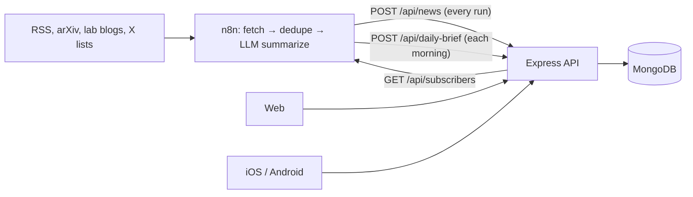

# n8n integration API

The contract between **n8n** (gathering and summarizing AI/SI news) and the **Global Super Intelligence News API**. n8n pushes stories and a daily brief in; it pulls subscriber lists out to send email.



## Authentication

Every n8n endpoint uses a shared secret in the `x-api-key` header, compared with the server's `API_KEY`.

| Condition | Response |
| --- | --- |
| Missing or wrong key | `401 { "error": "Invalid or missing API key" }` |
| Server has no `API_KEY` | `500 { "error": "Server misconfigured: API_KEY not set" }` |

Rate limit: 60 requests/minute per IP. Bodies up to 2 MB. Send batches rather than one request per story.

Base URLs: local `http://localhost:4000`, production `https://<your-render-service>.onrender.com`. Paths work with or without the `/v1` segment (`/api/news` and `/api/v1/news` are the same).

---

## 1. `POST /api/news` — push stories

Upserts by `url`. Re-sending the same URL updates it, so every run can resend everything it saw. Only fields you send are written; a partial update (for example `{ "title", "url", "urgent": true }` to flag a story as breaking) never blanks other fields. Editor curation (picks, hidden) and comment counts are never touched by ingest.

Body: one object or an array.

| Field | Type | Required | Notes |
| --- | --- | --- | --- |
| `title` | string | **yes** | Headline as published. |
| `url` | string | **yes** | `http(s)` only. The dedupe key. Alias: `link`. |
| `source` | string | no | Publication name. Default `RSS`. |
| `author` | string | no | Alias: `creator`. |
| `published` | ISO date / RFC 822 | no | Aliases: `pubDate`, `isoDate`, `published_at`. Defaults to ingest time on first insert. |
| `category` | string | no | One desk per story; see list below. Unknown values still display with a neutral color. |
| `tags` | string[] or comma string | no | Lower-cased, max 12. Power `#tag` pages and "Trending". |
| `urgent` | boolean | no | Breaking. Shows in the red bar for 24 h. Alias: `breaking`. |
| `headline` | string | no | One-line dek under the title. |
| `summary` | string | no | 2–4 sentence free summary. Aliases: `description`, `contentSnippet`. |
| `impact` | string | no | "Why it matters" (free). Alias: `why_it_matters`. |
| `analysis` | string | no | Longer **Premium** analysis. Paragraphs separated by blank lines. |
| `imageUrl` | string | no | `http(s)` image. Aliases: `image`, `thumbnail`. |

**Desks** (what the clients color and list in navigation):
`Frontier Models` · `Research` · `Safety & Alignment` · `Policy & Regulation` · `Industry & Funding` · `Compute & Hardware` · `Open Source` · `Superintelligence` · `Robotics`

Rename or add desks in `client/src/brand.js` and `mobile/lib/brand.dart`.

**Responses**

| Status | Body |
| --- | --- |
| `200` | `{ "ok": true, "received": n, "inserted": n, "updated": n }` |
| `400` | `{ "error": "Empty payload" }` |
| `400` | `{ "error": "Every item needs a title and a valid http(s) url", "invalidCount": n }` — the whole batch is rejected; filter first. |

```bash
curl -X POST "$API/api/news" \
  -H "Content-Type: application/json" -H "x-api-key: $API_KEY" \
  --data @samples/news-sample.json
```

### Suggested LLM step in n8n

Ask the model to return, per item: `category` (one of the desks), `tags` (3–6), `urgent` (true only for major, time-sensitive news), `headline` (≤ 20 words), `summary` (2–4 sentences), `impact` (1–2 sentences), and optionally `analysis` (3–6 short paragraphs) for the most significant stories.

No relevance score is needed. If an older workflow still sends `relevance`, it is ignored.

---

## 2. `POST /api/daily-brief` — push the morning edition

Upserted by calendar day; re-sending a day replaces it. Every item is also upserted into the story feed by `url`, so brief items always link to a story page with its discussion.

| Field | Type | Required | Notes |
| --- | --- | --- | --- |
| `briefing_date` | string | **yes** | e.g. `"October 15, 2026"` or ISO date. Normalized to UTC midnight. |
| `window_start`, `window_end` | string | no | Coverage window labels, shown as sent. |
| `summary` | string | no | Alias `morning_summary`. |
| `key_points` | string[] | no | |
| `stats_line` | string | no | e.g. `"42 stories in the last 24h"`. |
| `urgent_count`, `total` | number | no | |
| `app_items` | object[] | yes* | Preferred list. Same item fields as `/api/news`. |
| `items` | object[] | yes* | Used only when `app_items` is absent. |

`200 { "ok": true, "briefingDate": "...", "itemCount": n }`. See `samples/daily-brief-sample.json`.

The brief is readable by Premium members and staff on web and mobile.

---

## 3. `GET /api/subscribers` — who to email

| Query | Returns |
| --- | --- |
| *(none)* or `?audience=premium` | Premium members plus staff — recipients for the Daily Brief email. |
| `?audience=all` | Every non-banned account — for a free weekly digest. |

```json
{ "audience": "premium", "count": 2, "subscribers": [{ "name": "Ada", "email": "ada@example.com" }] }
```

---

## Public read endpoints (useful from n8n too)

No key needed.

| Endpoint | Use |
| --- | --- |
| `GET /api/news?category=&tag=&search=&since=&sort=latest\|discussed&page=&limit=` | The feed. |
| `GET /api/news/front-page` | Breaking, lead, picks, latest, most discussed. |
| `GET /api/news/:slugOrId` | One story plus related. |
| `GET /api/public/rss[?category=]` | RSS 2.0 of the latest 50 stories (also at `/rss.xml` on the web host). |
| `GET /api/public/sitemap.xml` | For search engines. |

## Migrating the existing Helio workflow

The old `POST /api/news` and `POST /api/daily-brief` payloads are accepted unchanged. To switch a copied Helio workflow over:

1. Point both HTTP Request nodes at the new API URL and new `API_KEY`.
2. Change the LLM prompt's category list to the desks above and ask for `tags`, `summary`, and (optionally) `analysis`. You can drop the relevance scoring step.
3. Drop the counsel/trainer/medical branches and the review-published webhook; this outlet has no expert-review flow.
