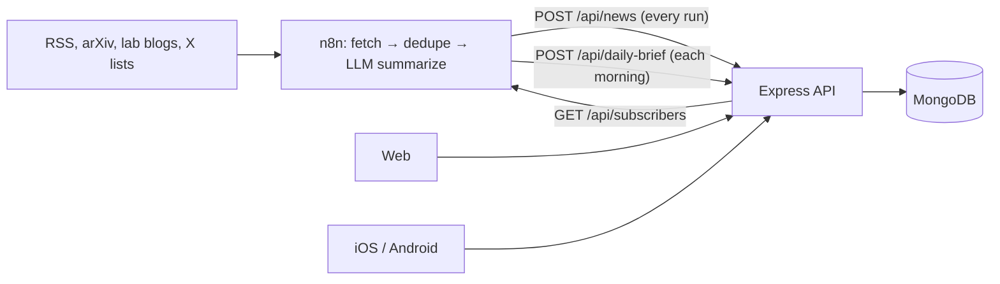

# n8n integration API

The contract between **n8n** (gathering and summarizing AI/SI news) and the **Global Super Intelligence News API**. n8n pushes stories and a daily brief in; it pulls subscriber lists out to send email.



## Authentication

Every n8n endpoint uses a shared secret in the `x-api-key` header, compared with the server's `API_KEY`.

| Condition | Response |
| --- | --- |
| Missing or wrong key | `401 { "error": "Invalid or missing API key" }` |
| Server has no `API_KEY` | `500 { "error": "Server misconfigured: API_KEY not set" }` |

Rate limit: 60 requests/minute per IP. Bodies up to 2 MB. Send batches rather than one request per story.

Base URLs: local `http://localhost:4000`, production `https://<your-render-service>.onrender.com`. Paths work with or without the `/v1` segment (`/api/news` and `/api/v1/news` are the same).

---

## 1. `POST /api/news` — push stories

Upserts by `url`. Re-sending the same URL updates it, so every run can resend everything it saw. Only fields you send are written; a partial update (for example `{ "title", "url", "urgent": true }` to flag a story as breaking) never blanks other fields. Editor curation (picks, hidden) and comment counts are never touched by ingest.

Body: one object or an array.

| Field | Type | Required | Notes |
| --- | --- | --- | --- |
| `title` | string | **yes** | Headline as published. |
| `url` | string | **yes** | `http(s)` only. The dedupe key. Alias: `link`. |
| `source` | string | no | Publication name. Default `RSS`. |
| `author` | string | no | Alias: `creator`. |
| `published` | ISO date / RFC 822 | no | Aliases: `pubDate`, `isoDate`, `published_at`. Defaults to ingest time on first insert. |
| `category` | string | no | One desk per story; see list below. Unknown values still display with a neutral color. |
| `tags` | string[] or comma string | no | Lower-cased, max 12. Power `#tag` pages and "Trending". |
| `urgent` | boolean | no | Breaking. Shows in the red bar for 24 h and, if the story is under 6 h old, sends one push alert to app users. Alias: `breaking`. |
| `headline` | string | no | One-line dek under the title. |
| `summary` | string | no | 2–4 sentence free summary. Aliases: `description`, `contentSnippet`. |
| `impact` | string | no | "Why it matters" (free). Alias: `why_it_matters`. |
| `analysis` | string | no | Longer analysis for major stories. Paragraphs separated by blank lines. |
| `imageUrl` | string | no | `http(s)` image. Aliases: `image`, `thumbnail`. |

**Desks** (what the clients color and list in navigation) are the Global SI domains:
`Frontier Models & AGI` · `Defense & National Security` · `Cybersecurity` · `Medical & Life Sciences` · `Policy & Regulation` · `Private Sector & Enterprise` · `Compute & Chips` · `Robotics & Autonomy` · `AI Safety & Alignment` · `Open Source & Developer Tools`

Rename or add desks in `client/src/brand.js` and `mobile/lib/brand.dart`.

### 1b. Global SI grading fields (optional, sent by the Radar)

The Global SI Radar grades every item against a strict rubric before it posts. All of these are optional; a plain RSS item without them still displays. When `domain` is present it becomes the desk (`category` on the wire), and the radar's `category` (the event type, e.g. `Model Release`) is kept as `kind`.

| Field | Type | Notes |
| --- | --- | --- |
| `domain` | string | One of the desks above. Stored as `category`. |
| `category` | string | Event type (`Model Release`, `Research Paper`, `Contract or Deployment`, …). Stored as `kind` when `domain` is present. |
| `urgency_tier` | 1–4 | 1 BREAKING · 2 SIGNAL · 3 BRIEFING · 4 LOGGED. Tier 1 is `urgent` by definition (one push alert if under 6 h old). |
| `tier_label` | string | Defaults from the tier. |
| `signal_score` | 0–100 | Relevance × freshness × primary source × corroboration. Drives the meter and gauge. |
| `relevance` | 0–100 | Kept as sent. |
| `primary_source` | boolean | The acting party itself published it (the "Verified source" seal). |
| `content_type` | string | `verified_reporting` or `reported`. |
| `dimensions` | string[] | Secondary desks. |
| `direction` | string | `advance`, `threat` or `neutral`. |
| `geo` | string | Region. |
| `horizon` | string | `now`, `upcoming` (dated event) or `background`. Powers the Watchlist. |
| `entities` | string[] | Named organizations, models, people. |
| `who_cares` | string | Who this affects. |
| `industry_line` | string | The plain-English line. Alias `consumer_line`. |
| `story_key` | string | Groups captures of one underlying story (`GET /api/news/story/:storyKey`). |
| `update_type` | string | `new`, `escalation` or `echo`. |
| `what_is_new` | string | For escalations. |
| `source_count` | number | Corroborating captures. |
| `captured_at` | ISO date | When the radar captured it (the status strip's "last sweep"). Alias `collected_date`. |

Field names are accepted in `snake_case` (as the radar sends them) and `camelCase`. Sample: `samples/globalsi-breaking.json`.

**Responses**

| Status | Body |
| --- | --- |
| `200` | `{ "ok": true, "received": n, "inserted": n, "updated": n, "alerted": n }` (`alerted`: push alerts sent) |
| `400` | `{ "error": "Empty payload" }` |
| `400` | `{ "error": "Every item needs a title and a valid http(s) url", "invalidCount": n }` — the whole batch is rejected; filter first. |

```bash
curl -X POST "$API/api/news" \
  -H "Content-Type: application/json" -H "x-api-key: $API_KEY" \
  --data @samples/news-sample.json
```

### Suggested LLM step in n8n

Ask the model to return, per item: `category` (one of the desks), `tags` (3–6), `urgent` (true only for major, time-sensitive news), `headline` (≤ 20 words), `summary` (2–4 sentences), `impact` (1–2 sentences), and optionally `analysis` (3–6 short paragraphs) for the most significant stories.

No relevance score is needed. If an older workflow still sends `relevance`, it is ignored.

---

## 2. `POST /api/daily-brief` — push the morning and evening editions

Upserted by calendar day **and** `brief_type`; re-sending an edition replaces it. Every item is also upserted into the story feed by `url` (with its grading, §1b), so brief items always link to a story page with its discussion. Posting a brief sends one "brief is out" push per edition (topic `PUSH_BRIEF_TOPIC`, default `brief`) when push is configured.

| Field | Type | Required | Notes |
| --- | --- | --- | --- |
| `briefing_date` | string | **yes** | e.g. `"October 15, 2026"` or ISO date. Normalized to UTC midnight. |
| `brief_type` | string | no | `morning` (default) or `evening`. Global SI posts both every day. |
| `plain_summary`, `watch_today`, `horizon_note` | string | no | Global SI reader-facing lines. |
| `generated_at` | ISO date | no | When the workflow produced it. |
| `content_labels` | object | no | Which sections are AI analysis vs reporting (shown as labels). |
| `confidence` | 0–100 | no | Evening only: the QA stage's confidence. |
| `qa_note` | string | no | Evening only. |
| `critical_intelligence` | object[] | no | Evening: `{ headline, why_it_matters, priority (HIGH/MEDIUM), domain, category, url }`. |
| `emerging_trends` | object[] | no | Evening: `{ trend, evidence, domain }`. |
| `cross_domain_insights` | string[] | no | Evening. |
| `forward_watchlist` | object[] | no | Evening: `{ item, window (24h/48h/72h), why }` — the analyst's forecast. |
| `watchlist_followup` | object[] | no | Evening: `{ predicted, status (confirmed/partial/missed/pending), evidence }` — yesterday's forecasts, graded. |
| `push` | object | no | `{ heading, body, url }` for the brief push notification. |
| `window_start`, `window_end` | string | no | Coverage window labels, shown as sent. |
| `summary` | string | no | Alias `morning_summary`. |
| `key_points` | string[] | no | |
| `stats_line` | string | no | e.g. `"42 stories in the last 24h"`. |
| `urgent_count`, `total` | number | no | |
| `app_items` | object[] | yes* | Preferred list. Same item fields as `/api/news`. |
| `items` | object[] | yes* | Used only when `app_items` is absent. |

`200 { "ok": true, "received": true, "briefingDate": "...", "brief_type": "evening", "date_slug": "YYYY-MM-DD", "itemCount": n, "alerted": 0|1 }`. Samples: `samples/daily-brief-sample.json` (legacy single edition), `samples/globalsi-morning-brief.json`, `samples/globalsi-evening-brief.json`.

Reads: `GET /api/daily-brief/latest?type=morning|evening`, `GET /api/daily-brief/list?limit=20&type=` (recent briefs without items), `GET /api/daily-brief/dates` (`{ dates[], editions[{date,type}] }`), `GET /api/daily-brief/:date[/:type]`.

The brief is free for everyone on web and mobile, no account needed.

---

## 3. `GET /api/subscribers` — who to email the Daily Brief

Every non-banned account that has the brief email turned on (it's on by default; readers switch it off in Account).

```json
{ "count": 2, "subscribers": [{ "name": "Ada", "email": "ada@example.com" }] }
```

Include an unsubscribe link in the email that points at `{WEB}/account`.

---

## 4. `GET /api/comments?hours=24` — reader discussion for the evening analyst

Key-protected (also at `GET /api/comments/recent?hours=24`). Visible comments from the last N hours, newest first, in the shape the Global SI Evening Daily Brief workflow consumes:

```json
[{ "article_url": "https://…", "article_title": "…", "story_key": "…", "comment_text": "…", "platform": "web|ios|android", "user_tier": "free|staff", "created_at": "…" }]
```

---

## Public read endpoints (useful from n8n too)

No key needed.

| Endpoint | Use |
| --- | --- |
| `GET /api/news?category=&domain=&tier=&horizon=&hours=&tag=&search=&since=&sort=latest\|discussed\|signal&page=&limit=` | The feed. `tier=3` = tiers 1–3; `domain` is an alias of `category` and may repeat; `hours` is a rolling window; `sort=signal` orders tier then signal. |
| `GET /api/news/status` | The radar strip: `{ source_count, last_capture_at, stories_24h, breaking_24h, latest_brief_at, latest_brief_type }`. |
| `GET /api/news/story/:storyKey` | `{ lead, captures[] }` — every capture of one story, primary source first. |
| `GET /api/news/front-page` | Breaking, lead, picks, latest, most discussed. |
| `GET /api/news/:slugOrId` | One story plus related. |
| `GET /api/public/rss[?category=]` | RSS 2.0 of the latest 50 stories (also at `/rss.xml` on the web host). |
| `GET /api/public/sitemap.xml` | For search engines. |
